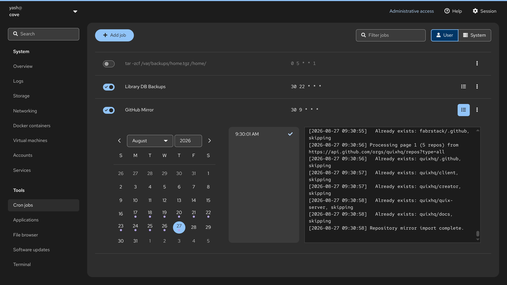

# Cockpit Cron

A simple [Cockpit](https://cockpit-project.org/) plugin for making it easier to manage cron jobs.

[](https://github.com/yashjawale/cockpit-cron/releases/latest)
[](https://github.com/yashjawale/cockpit-cron/actions/workflows/codecheck.yml)
[](https://github.com/yashjawale/cockpit-cron/actions)
[](https://copr.fedorainfracloud.org/coprs/yash/cockpit-plugins/package/cockpit-cron/)
[](https://launchpad.net/~yashjawale/+archive/ubuntu/cockpit-plugins)
[](https://build.opensuse.org/package/show/home:yashjawale/cockpit-cron)



# Features

- Easily enable/disable cron jobs without deleting them
- Add labels to jobs to help make identifying them easier
- View logs of the runs in the UI with a calendar interface
- Skip executing job until a certain time
- Supports both system & user cron

> Like what you see? Consider starring the repository 🌟

# Installation

Cockpit Cron is available from the following package sources. Install Cockpit
on your system first; the package manager will install it as a dependency where
applicable.

## Fedora and CentOS Stream (COPR)

Enable the [cockpit-plugins COPR repository](https://copr.fedorainfracloud.org/coprs/yash/cockpit-plugins/)
and install the package:

```sh
sudo dnf copr enable yash/cockpit-plugins
sudo dnf install cockpit-cron
```

## Debian, openSUSE, and other distributions via OpenBuildService repository

Use the [OBS download page](https://software.opensuse.org/download.html?project=home%3Ayashjawale&package=cockpit-cron)
to select your distribution and follow its repository setup instructions. Then
install `cockpit-cron` with your distribution's package manager.

## Ubuntu (PPA)

Add the [cockpit-plugins PPA](https://launchpad.net/~yashjawale/+archive/ubuntu/cockpit-plugins)
and install the package:

```sh
sudo add-apt-repository ppa:yashjawale/cockpit-plugins
sudo apt update
sudo apt install cockpit-cron
```

## Arch

Download the prebuilt Arch package from
[GitHub Releases](https://github.com/yashjawale/cockpit-cron/releases/latest)
and install it with:

```sh
sudo pacman -U ./cockpit-cron-bin-*.pkg.tar.zst
```

Alternatively, build from source:

```sh
sudo pacman -S --needed git base-devel gettext nodejs npm
git clone https://github.com/yashjawale/cockpit-cron.git
cd cockpit-cron
make dist
makepkg -si -p packaging/arch/PKGBUILD
```

> It is planned to release a package on aur too but currently waiting for the new account registration block to lift on aur.

## Manual binary installation (GitHub Releases)

Download the package for your distribution from
[GitHub Releases](https://github.com/yashjawale/cockpit-cron/releases/latest).
Releases include Debian `.deb` and RPM `.rpm` packages, as well as the source
tarball. Install a downloaded package using your system package manager, for
example:

```sh
sudo apt install ./cockpit-cron_*_all.deb
```

```sh
sudo dnf install ./cockpit-cron-*.noarch.rpm
```

> Not available for your distro or want another packaging format? Feel free to create an issue!

## Development

Install the build dependencies (`gettext`, Node.js, npm, and make; package names
may vary by distribution), then build:

```sh
git clone https://github.com/yashjawale/cockpit-cron.git
cd cockpit-cron
make
```

### Translations

Currently translations are maintained in `po/`. To regenerate the translation template
after changing translatable strings, run `make po/cockpit-cron.pot`.

> Translations are planned to be made available to contributors via Weblate. But since their Libre Gratis plan needs the package to have a bit of community activity. Can't post an application till the plugin gets a bit of users other than just me : )

### Tests

Run static checks and the browser integration test with:

```sh
make codecheck
TEST_BROWSER=firefox make check
```

### Local install

For development, build the project and link the bundle into Cockpit's user
package directory:

```sh
mkdir -p ~/.local/share/cockpit
ln -s "$(pwd)/dist" ~/.local/share/cockpit/cron
```

Alternatively, use `make devel-install`. After rebuilding with `make`, reload
Cockpit in your browser. Remove the development link with
`rm ~/.local/share/cockpit/cron` or `make devel-uninstall`.

---

<a href="https://yashjawale.github.io/" target="_blank"></a>
